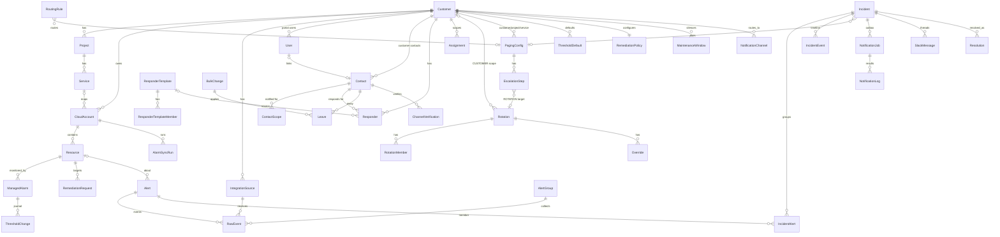

# 데이터 모델

상태: 초안 (4일차). 구현 에이전트는 이 문서와 `docs/API-CONTRACT.md`만 보고 Prisma 스키마를 만든다. 바꿀 때는 이 문서를 먼저 고친다.

- 저장소: Supabase Postgres(서울), 접근은 Prisma 한 경로, 스키마 변경은 `prisma migrate dev` / 배포는 `prisma migrate deploy`만(D-09 원칙 1·6, D-10). `prisma db push` 금지.
- 표준 SQL만 쓴다. `auth.uid()`, RLS, Supabase Auth·Realtime·Storage 의존 금지(D-09 원칙 1).
- 표기: `PK` 기본키, `FK` 외래키, `UQ` 유일, `IX` 인덱스, `?` null 허용. 근거는 명세 규칙 번호(예: `fingerprint F-1`) 또는 결정 ID(D-xx).
- **미결**로 표시한 것은 이 문서가 정하지 않는다. 맨 아래 "미결 목록"에 모았다.

## 0. 공통 원칙

| 원칙 | 내용 | 근거 |
|---|---|---|
| 테넌트 컬럼 | 고객사 데이터 테이블은 모두 `customerId`를 직접 가진다(트리를 거슬러 구하지 않고 비정규화). 조회 범위는 앱 계층의 `scope()`가 구한 customerId 집합을 모든 질의에 `WHERE customerId IN (...)`로 붙인다. 범위 조회 실패 시 빈 집합(닫는 쪽) | org-tenant R3-1, R3-3, 새 구현 2; D-09 원칙 1 |
| 테넌트 예외 | MSP 전역 설정 테이블(`SeverityMapping`, `SuppressionPolicy`, `ThresholdDefault`의 MSP 행, `TickHeartbeat`, `MspOrg`)은 customerId가 없거나 null. 미매핑 계정 알림(`RawEvent`, `Alert`, `AlertGroup`, `Incident`)은 `customerId = null` 허용, 전체 범위 사용자만 조회 | org-tenant R2-1, R2-2 |
| 시간 | 모두 `timestamptz`, UTC 저장, 화면 표시는 KST | 기존 DATA-MODEL 원칙 |
| ID | `cuid` 문자열. 결정적이어야 하는 키(그룹 ID, 인시던트 ID 등)는 명세 공식 그대로 | grouping G-4, I-2 |
| 동시성 | 경합하는 상태 행(`Alert`, `AlertGroup`, `Incident`, `ManagedAlarm`)은 `version int`를 두고 `UPDATE ... WHERE id=? AND version=?`로 쓴다. 충돌 시 재읽기 최대 3회 | grouping I-7, fingerprint F-4, known-bugs 3-2 |
| 중복 흡수 | 생성 경합은 `INSERT ... ON CONFLICT`(Prisma `upsert`/P2002 흡수)로 처리. 상태 전이는 상태 조건 `updateMany` | fingerprint F-7, known-bugs 1-6 |
| 부분 갱신 | 빈약한 후속 페이로드는 이미 아는 필드를 null로 덮지 않는다(`COALESCE` 갱신) | known-bugs 1-5 |
| 추가만 | `RawEvent`, `IncidentEvent`, `ThresholdChange`, `AuditLog`, `ContactRevealLog`, `NotificationLog`는 INSERT만 | fingerprint F-3, D-08 |
| 비밀값 | 토큰·서명 비밀은 평문 저장 금지. 수집 토큰은 SHA-256 해시 + 접두 4자만 저장. Slack 웹훅 URL 등 발송 비밀은 미결(아래 Q-DM-09) | org-tenant R5-1 |

## 1. 조직 · 사람 · 권한

### MspOrg (단일 행)
| 필드 | 타입 | 비고 |
|---|---|---|
| id | text PK | 고정값 `msp` |
| name | text | |
| defaultSlackChannelId | text? | 미매핑·스코프 채널 없음 시 전사 기본(notification R4-3, org-tenant R2-1) |
| createdAt, updatedAt | timestamptz | |

멀티 MSP는 범위 밖(미결 Q-DM-01).

### User (콘솔 로그인 계정)
| 필드 | 타입 | 비고 |
|---|---|---|
| id | text PK | |
| email | citext UQ | Google SSO(D-09 원칙 1) |
| name | text | |
| customerId | text? FK Customer (Cascade) | null = MSP 내부 인원, 값 = 고객사 담당자(org-tenant R1-4) |
| role | enum `ConsoleRole` | **미결**(Q-DM-02). 이식 후보: `VIEWER < OPERATOR < ADMIN`, 기본 OPERATOR, 고객사 담당자는 VIEWER 강제(org-tenant R4-1, R4-3) |
| seeAll | bool default false | 내부 인원 전체 범위(R3-1). 고객사 담당자는 항상 false |
| status | enum `PENDING, ACTIVE, DISABLED` | 첫 SSO는 PENDING, 관리자 사전 등록은 ACTIVE(R4-2) |
| lastLoginAt | timestamptz? | |
| createdAt, updatedAt | | |

- IX(customerId). 범위 계산: 고객사 담당자 → 자기 고객사, ADMIN·seeAll → 전체, 그 밖 → `Assignment`(직접 + 팀 경유)로 환산한 고객사(R3-1).
- 세션은 앱 쿠키(서명 JWT 또는 DB 세션 — 미결 Q-DM-03). open 모드(SSO 없음)는 두지 않는다(org-tenant 새 구현 4).

### Contact (알림 대상 인원, D-29)
로그인 계정과 별개. `kind`로 둘로 나뉜다: `INTERNAL`(MSP 직원) / `CUSTOMER`(고객 사람). 둘 다 `Responder`로 고객에 붙고, CUSTOMER도 Responder.role=PAGEABLE이면 단계·로테이션 대상이 된다(D-31 개정).

| 필드 | 타입 | 비고 |
|---|---|---|
| id | text PK | |
| kind | enum `INTERNAL, CUSTOMER` | D-29 |
| customerId | text? FK Customer (Cascade) | `INTERNAL`이면 null, `CUSTOMER`면 필수(CHECK). org-tenant R1-4, 0979b6f |
| userId | text? FK User UQ | 로그인과 연결(Slack 버튼 권한 판정에 사용, notification R6-2) |
| name | text | |
| email, phone, slackUserId | text? | phone은 E.164 |
| emailVerifiedAt, phoneVerifiedAt, slackVerifiedAt | timestamptz? | 주소가 바뀌면 null로 초기화(notification R9-1) |
| emailVerifiedVia, phoneVerifiedVia, slackVerifiedVia | text? | `code, link, sso, slack-lookup, admin:<name>` |
| active | bool default true | false면 담당 해석에서 빠지지만 배정 행은 유지(oncall R1-5) |
| createdAt, updatedAt | | |

- UQ(slackUserId) where not null, IX(customerId), IX(kind).
- `CUSTOMER` Contact는 **자기 고객**의 Responder·고객 로테이션·단계에만 들어갈 수 있다(다른 고객·MSP 로테이션 금지, 앱 검증 + 트리거). 단계·로테이션 대상이 되려면 Responder.role = PAGEABLE. Phone 칩은 SMS·Voice 두 채널로 표시.

### ContactScope (고객 사람이 알림받는 범위, D-29)
| 필드 | 타입 | 비고 |
|---|---|---|
| id | PK | |
| customerId | FK Customer (Cascade) | 비정규화 |
| contactId | FK Contact (Cascade) | kind = CUSTOMER만 |
| scopeType | enum `CUSTOMER, PROJECT, SERVICE` | |
| scopeId | text | |
| role | enum `NOTIFY, APPROVER, PORTAL_USER` | 한 사람이 여러 행 가능. APPROVER = 자동 조치 승인(D-15). 호출 여부는 여기가 아니라 Responder.role |
| createdAt | | |

- UQ(contactId, scopeType, scopeId, role), IX(customerId, scopeType, scopeId).
- 해석: 리소스 → Service → Project → Customer 순으로 **모두 합친다**(Assignment와 달리 가장 구체적인 하나가 아님). 화면의 "Inherited from …"과 알림 대상 계산은 같은 함수.

### ~~Team / TeamMember~~ (삭제, D-31 개정)
팀 개념 없음. 대신 고객별 `Responder`, 저장된 직원 묶음 `ResponderTemplate`, `Rotation(scope)`.

### Responder (고객별 응답자, D-30·D-31 개정)
| 필드 | 타입 | 비고 |
|---|---|---|
| customerId | FK Customer (Cascade) | PK(customerId, contactId) |
| contactId | FK Contact (Cascade) | INTERNAL 또는 그 고객의 CUSTOMER |
| role | enum `PAGEABLE, NOTIFY_ONLY` | INTERNAL은 항상 PAGEABLE. NOTIFY_ONLY는 단계·로테이션·전원에서 빠짐 |
| source | enum `TEMPLATE, DIRECT` | TEMPLATE이면 templateId |
| templateId | text? FK ResponderTemplate | 템플릿에서 온 행. 템플릿 멤버 변경 시 이 행이 추가·삭제됨(DIRECT 행은 유지) |
| createdBy, createdAt | | |

- "Everyone in Responders" = 이 고객의 role=PAGEABLE 전원(활성 Leave 대체 적용 후). Auto-fix approver·Portal은 ContactScope.role.
- IX(contactId) — People 화면 "customers covered".

### ResponderTemplate / ResponderTemplateMember
| ResponderTemplate | 타입 | 비고 |
|---|---|---|
| id, name | | UQ(name). 예: Infra core |
| updatedBy, updatedAt, version | | 변경 시 If-Match |

| ResponderTemplateMember | 비고 |
|---|---|
| templateId, contactId | PK. INTERNAL만 |

Customer.responderTemplateId text? FK — 고객이 쓰는 템플릿(하나, 선택).

### Customer
| 필드 | 타입 | 비고 |
|---|---|---|
| id | text PK | |
| name | text UQ | org-tenant R1-1 |
| slug | text UQ | 콘솔 주소·API 범위 필터의 고객 이름(`/c/<slug>/…`, `?customer=<slug>`). 형식·예약어는 아래 "slug 규칙" |
| isInternal | bool default false | 내부 시스템용 가짜 고객사(R1-2) |
| loginDomains | text[] | 비면 고객사 담당자 로그인 불가(R4-3) |
| portalGrants | text[] | `contacts, silences, channels` 중 선택, 기본 빈 값(R4-4) |
| defaultGroupWaitSec | int? | null이면 `SuppressionPolicy` 값 |
| createdAt, updatedAt | | |

AH의 `awsExternalId`, `ingestToken`은 각각 `CloudAccount.externalId`, `IntegrationSource.tokenHash`로 옮긴다. `aiInsights`는 D-14로 PoC 범위 밖.

### Project / Service
| Project | 타입 | 비고 |
|---|---|---|
| id | PK | |
| customerId | FK Customer (Cascade) | |
| name | text | UQ(customerId, name) (R1-1) |
| slug | text | UQ(customerId, slug). "slug 규칙" |

| Service | 타입 | 비고 |
|---|---|---|
| id | PK | |
| customerId | FK Customer | 비정규화(원칙 0) |
| projectId | FK Project (Cascade) | |
| name | text | UQ(projectId, name) |
| slug | text | UQ(projectId, slug). "slug 규칙" |

**slug 규칙 (Customer · Project · Service, D-33).**
- 형식 `^[a-z0-9][a-z0-9-]{0,63}$`. **부모 안에서 유일**: Customer는 MSP 전체, Project는 고객 안, Service는 프로젝트 안.
- **예약어는 쓸 수 없다**(세 단계 모두 같은 목록): `incidents` `incident` `monitoring` `call-order` `people` `maintenance` `thresholds` `alarms` `resources` `settings` `new` `-`. 주소에서 slug 자리와 화면 이름 자리가 겹치기 때문이다(`/c/<customer>/<project>/<service>/incident/<id>`, 포털 `/<project>/<service>/<screen>`). `-`는 미매핑 계정 인시던트의 고객 자리(`/c/-/incident/<id>`)다.
- 만들 때 이름에서 만든다(소문자, 영숫자 밖은 `-`, 한글 등으로 비면 `customer`·`project`·`service` + 짧은 접미사). 예약어이거나 부모 안에서 겹치면 `-2`, `-3`… 접미사를 붙인다. 직접 넣은 slug가 예약어·중복이면 400 `VALIDATION_FAILED` / 409 `ALREADY_EXISTS`.
- DB는 UQ와 형식 CHECK, 예약어는 서비스 계층에서 검증한다(목록이 화면 추가로 늘 수 있다).
- 만든 뒤에는 바꾸지 않는다(이름만 바뀐다). 이름 변경 때 slug도 바꿀지와 옛 주소 처리는 미결(API-CONTRACT Q-API-09).
- 마이그레이션: 기존 행은 이름에서 채운 뒤 NOT NULL.

### CloudAccount (고객 AWS 계정, D-07)
| 필드 | 타입 | 비고 |
|---|---|---|
| id | PK | |
| customerId | FK Customer (Cascade) | |
| serviceId | text? FK Service (SetNull) | 계정은 서비스 하나에만(R1-3). null = 고객사엔 매핑됐지만 서비스 미지정 |
| awsAccountId | char(12) UQ | 미매핑 판정 키 |
| alias | text? | |
| environment | enum `PRD, STG, DEV`? | 보강 1순위(R1-3) |
| regions | text[] default `{ap-northeast-2}` | 확인 리전. 글로벌 서비스는 us-east-1 추가 확인(alarm-rules §1-5) |
| externalId | text UQ | 필수(D-07). 생성 시 무작위 발급, 고객에게 표시 |
| readerRoleArn | text | 필수(D-07) |
| eventForwarderRoleArn | text | 필수(D-07) |
| alarmWriterRoleArn | text? | 선택(D-07) |
| tagWriterRoleArn | text? | 선택, `Monitoring` 키만(D-07, D-16) |
| remediatorRoleArn | text? | 선택(D-07, D-15) |
| alarmWriterEnabled, tagWriterEnabled, remediatorEnabled | bool default false | 고객이 고른 선택 기능. ARN이 있어도 꺼 둘 수 있음 |
| readerStatus, eventForwarderStatus, alarmWriterStatus, tagWriterStatus, remediatorStatus | enum `UNKNOWN, OK, DENIED, MISSING` | 연결 점검 결과(페르소나 P4-1) |
| lastCheckedAt | timestamptz? | |
| firstEventAt, lastEventAt | timestamptz? | 첫/마지막 수신(P4-1) |
| stackVersion | text? | 고객 스택 버전(옛 버전이면 기능 제한 표시) |
| createdAt, updatedAt | | |

- AlarmWriter가 없거나 꺼져 있으면 알람 엔진은 생성·동기화·고아 정리를 건너뛰고 읽기만 한다(alarm-sync 새 구현 4).

### Assignment (담당 배정)
| 필드 | 타입 | 비고 |
|---|---|---|
| id | PK | |
| customerId | FK | 비정규화 |
| scopeType | enum `CUSTOMER, PROJECT, SERVICE, ACCOUNT` | 네 단계 중 정확히 한 곳(oncall R1-1) |
| scopeId | text | 해당 행 id |
| contactId | text | (teamId 삭제, D-31 개정) |
| order | int | 0 = 1순위 |

- UQ(scopeType, scopeId, contactId)(known-bugs 7-4). IX(customerId). 페이징 대상 해석에는 쓰지 않는다(PagingConfig가 담당), Org & owners 표시용.
- 해석: 가장 구체적인 단계 하나만 통째로(R1-2), 상속 표시와 알림 해석은 같은 함수(R1-3, 1b27f2f).

### RoutingRule
| 필드 | 타입 | 비고 |
|---|---|---|
| id, customerId | | 고객사 단위(oncall R1-7) |
| priority | int | 작은 것 먼저, 같으면 createdAt |
| namespace, metric, resource | text? | `*` 글롭, 대소문자 무시 |
| severities | text[] | 비면 와일드카드 |
| serviceId | text? | |
| pagingConfigId | text? FK PagingConfig | 매치 시 쓸 단계(없으면 service › project › customer 해석) |
| enabled | bool | |

## 2. 수집 · 알림 · 인시던트

### IntegrationSource (D-06)
| 필드 | 타입 | 비고 |
|---|---|---|
| id | PK | |
| customerId | FK Customer (Cascade) | 웹훅의 고객사는 이 행으로만 정한다(본문 값 불신, backend 지침) |
| kind | enum `CLOUDWATCH, PROMETHEUS, GRAFANA` | CLOUDWATCH는 EventBridge 경로(토큰 없음) |
| name | text | UQ(customerId, name) |
| tokenHash | text? UQ | Prometheus/Grafana 전용. `in_` + 무작위 20바이트 hex 토큰의 SHA-256. 재발급 시 즉시 교체(R5-1) |
| tokenPrefix | char(4)? | 화면 표시용 |
| tokenRotatedAt | timestamptz? | |
| enabled | bool default true | |
| lastReceivedAt | timestamptz? | |

공용 토큰은 두지 않는다(org-tenant 새 구현 1, R5-5 차단).

### IngestRejection
| 필드 | 타입 | 비고 |
|---|---|---|
| id, receivedAt | | |
| customerId | text? | |
| sourceId | text? | |
| kind, reason | text | 예: `account_mismatch`, `bad_token`, `too_large` |
| awsAccountId, topicArn, title | text? | org-tenant R5-3 |

### RawEvent (원본 이벤트, 추가만)
| 필드 | 타입 | 비고 |
|---|---|---|
| id | PK | |
| dedupKey | text UQ | SQS 재전달 멱등. CloudWatch: `{occurredAt}#{eventId[:8]}`(fingerprint F-3), 웹훅: `{sourceId}:{fingerprint}:{startsAt}:{status}` 해시 |
| customerId | text? | 미매핑이면 null |
| sourceId | text? FK IntegrationSource | |
| source | enum `CLOUDWATCH, PROMETHEUS, GRAFANA` | |
| awsAccountId, region | text? | |
| fingerprint | text | 아래 Alert와 같은 값 |
| fingerprintVersion | int | 규칙 버전(fingerprint 제안 5) |
| state | enum `FIRING, RESOLVED, INSUFFICIENT_DATA` | fingerprint F-8 |
| previousState | text? | |
| severity | enum `SEV_1..SEV_5` | 정규화 값 |
| severityRaw | text? | 원문 보존(severity 새 구현 1) |
| occurredAt | timestamptz | 판정 기준 시각(suppression S-4) |
| receivedAt | timestamptz | |
| decision | enum `NOTIFY, SUPPRESS, DEFER`? | suppression S-1 |
| decisionReason | text? | S-13 값 |
| finalAction, finalReason, finalizedAt | ? | 그룹 finalize 결과(grouping G-7) |
| groupId | text? FK AlertGroup | 적재 시점 그룹(G-3) |
| alertId | FK Alert | |
| raw | jsonb | 64KB 상한, 넘으면 잘라 JSON을 유지하는 방식으로 요약 저장(known-bugs 1-4) |
| parseError | text? | `unmanaged alarm format` 등(F-2) |

- IX(customerId, occurredAt desc), IX(alertId, occurredAt desc), IX(groupId). 보관 기간 미결(Q-DM-10).

### Alert (지문 하나 = 한 행, 지문별 상태 포함)
| 필드 | 타입 | 비고 |
|---|---|---|
| id | PK | |
| fingerprint | text UQ | 형식 `{source}:{tenant}:{소스별 키}`. **소스별 규칙은 미결**(Q-DM-04). 임시: CloudWatch는 `{account}#{resource}#{metricKey}`, resource 없으면 ARN→이름 폴백(F-1, 20ebad9), Prometheus/Grafana는 네이티브 `fingerprint` |
| fingerprintVersion | int | |
| customerId | text? | |
| sourceId | text? | |
| source | enum | |
| awsAccountId, region | text? | |
| resourceId | text? FK Resource (SetNull) | 해석됐으면 연결 |
| resourceType, metricKey, namespace | text? | |
| title | text | |
| status | enum `FIRING, ACKNOWLEDGED, RESOLVED, INSUFFICIENT_DATA` | ack 고착(suppression S-9, oncall R6-2): FIRING 재수신은 상태가 FIRING·ACKNOWLEDGED가 아닐 때만 전이 |
| severity | enum SEV | UNKNOWN으로 덮지 않음(severity V-6 갱신 규칙) |
| severityRaw | text? | |
| value, threshold | numeric? | |
| comparison | text? | |
| lastNotifiedAt | timestamptz? | dedup 기준(S-8). 에스컬레이션 발송은 갱신하지 않음(notification 새 구현 4) |
| episodeOpen | bool | F-4 |
| episodeStartedAt | timestamptz? | |
| episodeNotified | bool | |
| recentEpisodes | timestamptz[] | flapping 창, 상한 30(S-7) |
| quarantinedUntil | timestamptz? | |
| fireCount | int | |
| firstSeenAt, lastEventAt | timestamptz | |
| version | int | |

- IX(customerId, status), IX(customerId, lastEventAt desc), IX(awsAccountId).
- 상태 행 TTL 30일 개념(F-4)은 "30일 조용하면 첫 발화로 본다"는 판정 규칙으로 옮기고 행은 지우지 않는다.

### AlertGroup (group_wait 묶음)
| 필드 | 타입 | 비고 |
|---|---|---|
| id | text PK | `g-{sha1(groupKey)[:16]}-{openedAt yyyymmddHHMMSS}`(G-4) |
| groupKey | text | `{customerId or awsAccountId}#{severity}`(G-1). 서비스 포함 여부 검토(grouping 새 구현 5) |
| customerId | text? | |
| severity | enum SEV | |
| status | enum `OPEN, CLOSED, FINALIZED, DELIVERED` | |
| openedAt | timestamptz | |
| groupWaitSec | int | 열 때 값 고정(G-5) |
| closeAt | timestamptz | openedAt + groupWaitSec |
| pauseUntil | timestamptz? | DEFER 구성원이 있을 때(S-10) |
| staleAfter | timestamptz | `wait + grace + 최대 auto_pause + 여유`(grouping 새 구현 3) |
| deliveredAt | timestamptz? | 발송 선점(claim)(notification R2-3) |
| sweptReason | text? | |
| version | int | |

- 부분 UQ(groupKey) where status = 'OPEN' — 축당 열린 그룹 하나(G-3). IX(status, closeAt) — 틱이 처리할 그룹 선택.
- Step Functions 대신 1분 틱 + SQS 지연 메시지(grouping 새 구현 2). 틱 1분 단위라 group_wait 30초 정밀도 처리 방식은 API-CONTRACT 참조.

### Incident
| 필드 | 타입 | 비고 |
|---|---|---|
| id | text PK | `inc-{sha1(axis)[:12]}-{triggeredAt 14자}`(I-2) |
| axis | text | = groupKey(I-2, 277af15) |
| customerId | text? | |
| number | int | 화면 표시용 일련번호(전역 시퀀스) |
| title | text | 대표 = 가장 심각한 구성원(G-9) |
| severity | enum SEV | |
| status | enum `TRIGGERED, ACKNOWLEDGED, RESOLVED` | I-1 |
| triggeredAt, acknowledgedAt, resolvedAt | timestamptz? | |
| acknowledgedBy, resolvedBy | text? FK User/Contact | |
| resolvedVia | enum `MANUAL, AUTO, RECONCILE`? | I-6, oncall R7-1 |
| mttaSec, mttrSec | int? | I-5 |
| memberCount, eventCount | int | 구성원 최대 200(I-4) |
| accountIds, resourceTypes | text[] | 채널 조건 매칭(I-4, 71aa6e2) |
| assignmentSnapshot | jsonb? | `{capturedAt, pagingConfigId, level, steps[{index,atMin,targetType,targetId,resolved[{contactId,name,via}]}], leaveApplied[]}`(oncall R3-1). 연락 수단은 저장하지 않음(R3-2) |
| pagingConfigId | text? FK PagingConfig | 발화 시점 고정 |
| escalationStep | int default 0 | 현재 단계 인덱스 |
| escalationRepeat | int default 0 | 사다리를 몇 번 돌았나(D-20) |
| escalationBaseAt | timestamptz? | 직전 통지 시각(oncall R4-2) |
| escalationDoneAt | timestamptz? | 반복까지 끝남 |
| renotifiedAt | timestamptz? | ack 후 재알림(I-6 4, R5-2) |
| rcaPlaceholder | jsonb? | D-14 자리만 |
| version | int | |
| isMergeTarget | bool | AAM 포인터 `inc#{axis}` 대체. 새 구성원을 합칠 대상 |

- 부분 UQ(axis) where isMergeTarget — 축당 병합 대상 하나. 6시간 지난 인시던트는 열린 채 두되 isMergeTarget=false로 내리고 새 인시던트를 연다(I-3).
- IX(customerId, status, triggeredAt desc), IX(status, escalationBaseAt) — 에스컬레이션 틱.
- **Ack 단위(인시던트/알림)는 미결**(Q-DM-05). 위 구조는 둘 다 담는다: 인시던트 상태와 Alert.status를 따로 둔다. 제안은 인시던트 단위 ack + 알림 ack 고착(grouping 새 구현 1).

### IncidentAlert
| 필드 | 타입 | 비고 |
|---|---|---|
| incidentId | FK Incident (Cascade) | PK(incidentId, alertId) |
| alertId | FK Alert | |
| customerId | text? | |
| joinedAt | timestamptz | |
| eventCount | int | 같은 지문 반복은 이 값만 증가(I-4) |

### IncidentEvent (타임라인, 추가만)
| 필드 | 타입 | 비고 |
|---|---|---|
| id, incidentId, customerId | | |
| at | timestamptz | |
| kind | enum `TRIGGERED, MERGED, ACKED, RESOLVED, ESCALATED, NOTIFIED, RENOTIFIED, SUPPRESSED, MUTED, REMEDIATION, NOTE` | |
| actorType | enum `USER, CONTACT, SYSTEM, PROVIDER` | |
| actorId | text? | |
| message | text | 에스컬레이션은 기준 시각 포함 문구(oncall R4-3, 8b98366) |
| data | jsonb? | |

- IX(incidentId, at). 타임라인 화면 상한은 API에서 자른다(첫 TRIGGERED 항목 고정, I-4/517b3d3).

### Resolution (해결 기록)
| 필드 | 타입 | 비고 |
|---|---|---|
| id, customerId, incidentId, alertId? | | |
| via | enum `MANUAL, AUTO` | oncall R7-1 |
| kind | enum `RESTART, CONFIG, AUTO, OTHER`? | 한 번 클릭 분류(R7-2) |
| note | text? | |
| serviceId, metricKey, resourceId | text? | "이전 처리" tier 매칭(R7-4) |
| durationSec, escalationStep | int | |
| resolvedBy | text? | |
| resolvedAt | timestamptz | |
| recurredAt | timestamptz? | 24시간 안 재발(R7-3) |

- IX(customerId, serviceId, metricKey, resolvedAt desc).

## 3. 노이즈 제어

### SuppressionPolicy (MSP 전역 단일 행 + 고객사 덮어쓰기 미결)
| 필드 | 타입 | 기본 | 범위 | 근거 |
|---|---|---|---|---|
| id | text PK (`global`) | | | |
| repeatIntervalSec | int | 900 | 0~86400 | S-8, 15분 통일 제안 |
| flappingPerDay | int | 3 | 1~1000 | S-7 |
| flappingWindowDays | numeric | 1 | 1/24~30 | S-7 |
| flappingQuarantineSec | int | 3600 | 0~86400 | S-7 |
| groupWaitSec | int | 30 | 0~300 | G-5 |
| autoPauseSec | jsonb `{SEV_n: sec}` | `{}` | 0~3600 | S-10, 기본 비활성 |
| renotifyAfterSec | int | 3600 | 0~86400 | I-6, S-11 결함 재현 테스트 대상 |
| incidentMergeMaxSec | int | 21600 | | I-3 6시간 |
| updatedBy, updatedAt | | | | |

- SEV-1 면제는 설정이 아니라 고정 규칙(D-17). `exempt_severities` 컬럼을 두지 않는다.
- 환경변수 계층은 두지 않는다(D-19 정신, suppression 새 구현 3: env는 초기 시드만). 고객사별 덮어쓰기 여부 미결(Q-DM-06).

### MaintenanceWindow (점검 창, D-17)
| 필드 | 타입 | 비고 |
|---|---|---|
| id | PK | |
| customerId | text? | null = 전체(MSP ADMIN만) |
| scopeType | enum `CUSTOMER, PROJECT, SERVICE, ACCOUNT, RESOURCE_TYPE, ALERT` | 범위 축은 **미결**(Q-DM-07). 이 열거값은 suppression 새 구현 2의 제안(AH 범위 + 계정·리소스 타입) |
| scopeId | text? | |
| resourceType | text? | RESOURCE_TYPE일 때 |
| startsAt, endsAt | timestamptz | `startsAt ≤ now < endsAt`(S-5). 최대 30일, 이미 끝난 구간 거절 |
| reason | varchar(200) | |
| createdBy | text | |
| revokedAt, revokedBy | ? | S-6 |
| createdAt | | |

- 효과(D-17): **모든 소스에 하나의 규칙. SEV-1은 점검 창 중에도 울리고, SEV-2 이하는 묵음.** 묵음 = 통지·에스컬레이션만 멈춤, 수집·상태·화면은 계속(S-6). "SEV-1 포함" 선택지는 두지 않는다(D-17이 제안을 대체).
- IX(customerId, endsAt), IX(scopeType, scopeId). Slack "1시간 뮤트" 버튼은 ALERT 범위 창 생성(notification R6-4).

### SeverityMapping (D-18)
| 필드 | 타입 | 비고 |
|---|---|---|
| id | PK | |
| matchValue | text UQ | 소문자 정규화한 외부 값(예: `critical`, `warning`, `info`, `sev-2`) |
| severity | enum SEV | |
| updatedBy, updatedAt | | |

- **표 하나, 소스별·고객사별 열 없음**(D-18). customerId·source 컬럼을 두지 않는 것이 이 결정의 구현이다.
- `sev[-\s]?n`(1~5) 패턴은 표 이전에 그대로 해석(severity 새 구현 2). 범위 밖 숫자는 무시.
- CloudWatch 우리 알람은 설명 JSON `severity`가 우선(V-4). 표의 실제 값(`critical`→SEV-1/SEV-2)과 매핑 실패 시 기본 등급은 **미결**(Q-DM-08).

## 4. 리소스 · 알람 엔진

### Resource (D-16)
| 필드 | 타입 | 비고 |
|---|---|---|
| id | PK | |
| customerId | FK | |
| cloudAccountId | FK CloudAccount (Cascade) | |
| region | text | 리소스 리전(known-bugs 4-3) |
| resourceType | text | 29종 키(alarm-rules §3) |
| resourceArn | text | |
| resourceKey | text | 엔진이 쓰는 ID(ELB는 Full ARN) |
| name | text? | `Name` 태그 |
| tags | jsonb | 마지막으로 읽은 태그 사본(읽기 전용, D-08) |
| monitoringTag | enum `ON, OFF, ABSENT` | `Monitoring` 값(대소문자 무시, alarm-rules §4-1) |
| monitoringState | enum `MONITORED, NEEDS_REVIEW, NOT_MONITORED, DELETED` | **NEEDS_REVIEW = 콘솔 "확인 필요"**: 감시 중이던 리소스의 태그가 밖에서 사라짐. 알람은 지우지 않는다(D-16) |
| needsReviewSince | timestamptz? | |
| needsReviewReason | text? | `tag_removed`, `tag_unreadable` 등 |
| monitoringTagSetBy | enum `CUSTOMER, CONSOLE`? | TagWriter로 콘솔이 붙였는지(D-16) |
| lastSeenAt | timestamptz | |
| discoveryRunId | text? | |
| createdAt, updatedAt | | |

- UQ(cloudAccountId, region, resourceType, resourceKey). IX(customerId, resourceType, monitoringState).
- 발견 실패와 0건을 구분해 실패 시 행을 지우지 않는다(known-bugs 4-9). 태그를 못 읽으면 상태를 바꾸지 않는다(alarm-sync §6-3).
- AAM의 "태그 제거 → 알람 삭제"(10e6444)는 D-16으로 바뀐다: 제거 → NEEDS_REVIEW. 사람이 "감시 해제"를 고르면 그때 알람 삭제. 리소스가 실제로 삭제되면 DELETED + 알람 삭제(alarm-sync §6-3 유지).

### ThresholdDefault (D-19, 4단계 중 DB 2단계)
| 필드 | 타입 | 비고 |
|---|---|---|
| id | PK | |
| level | enum `MSP, CUSTOMER` | 코드 기본값은 알람 엔진 레지스트리(DB 아님), 리소스 값은 ManagedAlarm/태그 |
| customerId | text? | MSP면 null |
| resourceType | text | |
| metricKey | text | |
| threshold | numeric? | null이면 이 단계는 값 없음 |
| off | bool default false | 이 단계에서 지표 끄기 |
| periodSec, statistic | int?, enum? | 콘솔 지정 주기(60·300·900·3600)와 통계. 없으면 정의값(D-27) |
| evalM, evalN | int? | `1 ≤ M ≤ N ≤ 10`. 잠긴 정의(SEV-1, period ≥ 3600)는 무시(alarm-rules §2-4) |
| updatedBy, updatedAt | | |

- UQ(level, customerId, resourceType, metricKey) — MSP 행은 customerId null이라 `NULLS NOT DISTINCT`(PG15+) 또는 `customerId`에 `''` 센티널. 구현은 NULLS NOT DISTINCT.
- 해석 순서(D-19): **코드 기본값 < MSP 기본값 < 고객사 기본값 < 리소스별 값(콘솔 또는 고객 태그, 태그 우선)**. 환경변수 계층 없음(D-19, backend 지침). 해석기는 값과 함께 출처 `CODE | MSP | CUSTOMER | CONSOLE | TAG`를 돌려준다(콘솔에 모든 값의 출처 표시, D-19).
- 디스크 경로별(`Disk_*`) 기본값 층 적용 여부는 AAM에서 빠져 있었음(alarm-rules §5) → 미결(Q-DM-11).

### ManagedAlarm (우리가 만든 CloudWatch 알람의 사본, D-08)
| 필드 | 타입 | 비고 |
|---|---|---|
| id | PK | |
| customerId | FK | |
| resourceId | FK Resource | |
| cloudAccountId | FK | |
| region | text | 글로벌 타입은 us-east-1 |
| metricKey | text | 디스크는 `Disk_{suffix}` |
| alarmName | text | **리소스 + 지표로 고정, 임계치를 넣지 않는다**(D-08). 형식 `[{type}] {label} {metricDisplay} (TagName: {shortId})` — 기존 형식에서 `{방향} {임계치}{단위}`만 뺀 것 |
| alarmArn | text | 고객 계정 ID가 들어 있어야 함(1a1080b) |
| severity | enum SEV | 알람 `Severity` 태그 = 설명 JSON(alarm-sync §3) |
| severityManual | bool | 수동 등급(F8) |
| threshold | numeric | CloudWatch 단위 실제 값 |
| thresholdSource | enum `CODE, MSP, CUSTOMER, CONSOLE, TAG` | D-19 출처 |
| consoleThreshold | numeric? | 콘솔 리소스별 값의 사본. **정본은 고객 계정의 알람**(D-08). 알람 내 저장 형식(태그 vs 설명 JSON)은 미결(Q-DM-12) |
| evalM, evalN | int | |
| evalSource | enum (같은 출처) | |
| comparison, statistic, period, treatMissingData | | 드리프트 비교 필드(`_CONFIG_FIELDS`, alarm-sync §5-3) |
| state | enum `OK, ALARM, INSUFFICIENT_DATA`? | 마지막으로 본 상태 |
| driftStatus | enum `IN_SYNC, DRIFTED, MISSING, EXTERNAL_CHANGE` | 밖에서 바뀜(페르소나 P4-5) |
| driftDetail | jsonb? | 기대값 vs 실제값, 바꾼 주체(CloudTrail에서 알면) |
| lastSyncedAt | timestamptz? | |
| version | int | |

- UQ(cloudAccountId, region, alarmName), UQ(resourceId, metricKey). IX(customerId, driftStatus).
- 임계치 변경은 **같은 알람을 제자리 수정**(`PutMetricAlarm` 같은 이름)으로, 삭제·재생성하지 않는다(D-08). 이름에 임계치가 없으므로 fingerprint(F-1)도 바뀌지 않는다.
- 소유 판정은 설명 메타데이터로만(f376969), 이 테이블에 없다는 이유로 고객 알람을 지우지 않는다.

### ThresholdChange (변경 기록, 추가만, D-08)
| 필드 | 타입 | 비고 |
|---|---|---|
| id, at | | |
| customerId | FK | |
| target | enum `ALARM, CUSTOMER_DEFAULT, MSP_DEFAULT, SEVERITY, MONITORING_TAG` | |
| managedAlarmId, resourceId | text? | |
| resourceType, metricKey | text | |
| field | enum `THRESHOLD, EVAL, OFF, SEVERITY, MONITORING` | |
| oldValue, newValue | jsonb | |
| oldSource, newSource | text? | |
| actorType | enum `USER, SYSTEM, EXTERNAL` | EXTERNAL = 콘솔 밖 변경 감지 |
| actorId | text? | |
| reason | text? | |
| applyStatus | enum `PENDING, APPLIED, FAILED, SKIPPED_TAG_WINS` | 태그가 이기면 적용 안 됨 |
| commandId | text? | 알람 엔진 명령(API-CONTRACT §6) |
| error | text? | |

- IX(customerId, at desc), IX(managedAlarmId, at desc). 알람이 사라졌을 때 콘솔 값 복구 원천(alarm-sync 새 구현 8).

### AlarmSyncRun
| 필드 | 타입 | 비고 |
|---|---|---|
| id | PK | |
| customerId, cloudAccountId | | |
| mode | enum `DAILY, TAG_RECONCILE, ON_DEMAND, CLOUDTRAIL` | alarm-sync §6 |
| status | enum `RUNNING, SUCCEEDED, FAILED, PARTIAL` | |
| startedAt, finishedAt, heartbeatAt | | 멈춘 RUNNING은 일정 시간 뒤 FAILED 정리(known-bugs 4-15) |
| counts | jsonb | created/updated/refreshed/deleted/needsReview/errors |
| error | text? | |

### RemediationPolicy (D-15)
| 필드 | 타입 | 비고 |
|---|---|---|
| customerId | PK FK | 고객사별 하나 |
| enabled | bool default **false** | D-15 기본 꺼짐 |
| mode | enum `NOTIFY_ONLY, APPROVAL_REQUIRED` default **NOTIFY_ONLY** | D-15 "처음엔 알림만". 자동 실행 모드는 없다 |
| actions | text[] | `EC2_STOP, RDS_STOP, ELB_DELETE`(alarm-sync §6-4) 중 허용 |
| approverRole | enum ConsoleRole | 승인 가능 최소 역할(역할 체계 미결 Q-DM-02에 종속) |
| updatedBy, updatedAt | | |

- 실행은 `CloudAccount.remediatorEnabled`와 `remediatorRoleArn`이 있을 때만(D-07, D-15).

### RemediationRequest
| 필드 | 타입 | 비고 |
|---|---|---|
| id | PK | |
| customerId, cloudAccountId, resourceId | | |
| trigger | jsonb | 무단 변경 CloudTrail 이벤트 요약 |
| action | enum | |
| status | enum `NOTIFIED, PENDING_APPROVAL, APPROVED, REJECTED, EXPIRED, EXECUTING, SUCCEEDED, FAILED` | |
| requestedAt, expiresAt | | 만료 시간 값은 미결(Q-DM-13) |
| decidedBy | text? FK Contact | Slack 승인자(D-15) |
| decidedAt, decisionVia | ? | `SLACK` 만(D-15 "Slack에서 사람 승인") |
| executedAt, result | ? | |
| slackMessageId | text? | |
| version | int | 승인 이중 클릭 방지 |

- UQ(customerId, resourceId, action) where status in (`PENDING_APPROVAL`,`APPROVED`,`EXECUTING`) — 같은 리소스에 동시 요청 하나.

## 5. 온콜 · 에스컬레이션 (D-11, D-30·D-31 개정)

### Rotation
| 필드 | 타입 | 비고 |
|---|---|---|
| id | PK | |
| scope | enum `MSP, CUSTOMER` | MSP = 공용(On-call › Rotations, 여러 고객이 참조), CUSTOMER = 그 고객 전용 |
| customerId | text? FK | scope=CUSTOMER면 필수(CHECK) |
| name | text | UQ(customerId, name) |
| cadence | enum `DAILY, WEEKLY` | |
| handoverDow, handoverMin | smallint | 예: 매일 09:00, 월 10:00 |
| anchorAt | timestamptz | 1번 멤버가 시작한 교대 |
| timezone | text default `Asia/Seoul` | |

| RotationMember | 비고 |
|---|---|
| rotationId, contactId, order | PK(rotationId, contactId). MSP 로테이션은 INTERNAL만. CUSTOMER 로테이션은 INTERNAL + 그 고객의 PAGEABLE Responder |

당번 = members[(교대 번호) mod N] → 수락된 Override → 활성 Leave 대체 순으로 덮는다.

### Override (대체 근무, 한 로테이션)
| 필드 | 타입 | 비고 |
|---|---|---|
| id, rotationId, contactId | | contactId = 대신 서는 사람 |
| startAt, endAt | timestamptz | `[startAt, endAt)` |
| reason, createdBy | |
| kind | enum `COVER, SWAP` | D-28 유지 |
| status | enum `PENDING, ACCEPTED, DECLINED, CANCELLED` | 해석에는 ACCEPTED만 |
| requestedAt, respondedAt | timestamptz? | |

### Leave (휴가 대체, 모든 고객·로테이션, D-31 개정)
| 필드 | 타입 | 비고 |
|---|---|---|
| id | PK | |
| contactId | FK Contact | 자리를 비우는 직원 |
| replacementId | FK Contact | 대체자(INTERNAL) |
| startDate, endDate | date | KST, 양끝 포함 |
| createdBy, createdAt, cancelledAt? | | |
| bulkChangeId | FK BulkChange | 적용 시 미리보기 결과 |

해석 시점 적용(행을 복사하지 않음): 기간 중 ① PERSON 단계의 contactId → replacementId ② ALL_RESPONDERS에서 contactId 제외, replacementId 포함(이미 있으면 중복 없음) ③ 로테이션 시프트의 당번이 contactId면 replacementId. 끝나면 자동 원복.

### BulkChange (일괄 변경 감사, 추가만)
| 필드 | 타입 | 비고 |
|---|---|---|
| id | PK | |
| kind | enum `LEAVE_REPLACE, ADD_STAFF, TEMPLATE_UPDATE` | |
| actorId | FK User | |
| params | jsonb | `{contactId, replacementId, from, to}` / `{contactId, customerIds[]}` / `{templateId, added[], removed[]}` |
| preview | jsonb | 적용 시점 미리보기 `{customers[{id, effects[]}], rotations[{id, shifts[]}], totals}` — 화면 문구 그대로 |
| previewHash | text | 미리보기 이후 데이터가 바뀌면 적용 409 |
| createdAt | | AuditLog에도 한 줄 |

### PagingConfig (고객·프로젝트·서비스별 단계, 구 EscalationPolicy)
| 필드 | 타입 | 비고 |
|---|---|---|
| id | PK | |
| customerId | FK | |
| scopeType | enum `CUSTOMER, PROJECT, SERVICE` | UQ(scopeType, scopeId). CUSTOMER 행은 고객당 필수 1개, 나머지는 선택 덮어쓰기 |
| scopeId | text | |
| style | enum `ALL_AT_ONCE, CUSTOMER_ROTATION, SHARED_ROTATION, CUSTOM` | 화면 표시·편집기 시작점 |
| plan | enum `STANDARD, URGENT, QUIET` | 시작 템플릿 이름 |
| edited | bool | 템플릿에서 만든 뒤 단계를 고쳤으면 true("(edited)") |
| repeatCount | int default 1 | D-20 |
| renotifyAfterAckSec | int? | |
| version, updatedBy, updatedAt | | If-Match |

해석: 리소스의 service › project › customer 중 **처음 있는 행 하나**(합치지 않음). Incident에는 발화 시점 pagingConfigId와 단계 스냅샷을 고정.

### EscalationStep
| 필드 | 타입 | 비고 |
|---|---|---|
| id, pagingConfigId | | |
| index | int | UQ(pagingConfigId, index) |
| atMin | int | 인시던트 시작 기준 분(화면 "At") |
| targetType | enum `PERSON, ROTATION, ALL_RESPONDERS` | D-30 개정 |
| targetId | text? | PERSON → contactId(그 고객 PAGEABLE Responder 또는 INTERNAL), ROTATION → rotationId(MSP 또는 그 고객 CUSTOMER), ALL_RESPONDERS → null |
| channels | text[] | `SLACK_CHANNEL, SLACK_DM, SMS, VOICE, EMAIL` |
| advanceOnAllFail | bool default false | |

- 시작 템플릿(코드 상수): STANDARD 0 Slack P → 2 SMS P → 7 Call P → 12 Call ALL / URGENT 0 Call P → 5 Call ALL / QUIET 0 Slack P → 15 Slack ALL. P = 첫 대상(로테이션 또는 ALL). ALL_AT_ONCE면 마지막 ALL 단계는 생략.
- 뮤트 종료 직후 밀린 단계 처리(R4-6)는 미결(Q-DM-15).
- 구 `Schedule`, `CustomerEscalation`, `EscalationPolicy.teamId/preset/basedOnPolicyId`, target `SNAPSHOT_NEXT/SNAPSHOT_ALL/TEAM/SCHEDULE`은 삭제.

## 6. 통지

### NotificationChannel (발송 목적지)
| 필드 | 타입 | 비고 |
|---|---|---|
| id | PK | |
| customerId | text? | |
| scopeType, scopeId | | CUSTOMER/PROJECT/SERVICE. 가장 구체적인 단계 목록 통째로(notification R4-3) |
| kind | enum `SLACK_BOT, SLACK_WEBHOOK, EMAIL` | SMS·음성은 Contact 대상이라 여기 없음 |
| slackChannelId | text? | |
| webhookSecretRef | text? | 비밀 저장 방식 미결(Q-DM-09) |
| conditions | jsonb? | 계정·리소스 타입 조건(AAM, notification §10) |
| verifiedAt | timestamptz? | 테스트 발송 성공 |
| enabled | bool | |

- UQ(scopeType, scopeId, kind, slackChannelId) — 조용한 덮어쓰기 금지(4b5b079, 409).

### ChannelVerification
| 필드 | 타입 | 비고 |
|---|---|---|
| id, customerId? | | |
| contactId | FK | |
| channel | enum `EMAIL, SMS, SLACK` | |
| tokenHash | text UQ | 24시간 1회용(notification R9-2) |
| sentAt, expiresAt, usedAt | | |
| via | text | `link, code, admin:<name>` |
| note | text? | 수동 확인 메모 |

- 확인 상태가 발송을 막는지는 미결(Q-DM-16, notification 새 구현 5).

### NotificationJob (아웃박스)
| 필드 | 타입 | 비고 |
|---|---|---|
| id | PK | |
| idempotencyKey | text UQ | `{incidentId}:{purpose}:{step}:{repeat}:{channel}:{targetId}` |
| customerId | text? | |
| incidentId | FK | |
| purpose | enum `INITIAL, ESCALATION, RENOTIFY, RESOLVED, DIGEST, REMEDIATION_APPROVAL` | |
| channel | enum `SLACK_BOT, SLACK_WEBHOOK, SLACK_DM, EMAIL, SMS, VOICE` | |
| targetRef | text | 채널 id 또는 contactId |
| groupKey | text? | Slack 다이제스트 키 `service:{id}`(notification R2-1) |
| status | enum `QUEUED, SENDING, SENT, FAILED, SKIPPED` | |
| attempts | int | 최대 5, 간격 30s/1m/2m/5m/10m(R1-2) |
| nextAttemptAt | timestamptz | 선점 시 미리 기록 |
| lastError | text? | |
| payload | jsonb | |

- IX(status, nextAttemptAt).

### NotificationLog (추가만)
| 필드 | 비고 |
|---|---|
| id, at, customerId?, incidentId, jobId | |
| channel, status(`SENT, FAILED`) | skipped는 남기지 않음(R1-3) |
| targetSummary | "1순위 이름 외 n명" |
| escalationStep | |
| providerMessageId | 문자·음성 업체 ID, Slack ts |
| error | |

- IX(incidentId, at). 고객 포털 "통지가 실제로 나갔는지"(P3-2)의 원천.

### SlackMessage (스레드 매핑)
| 필드 | 비고 |
|---|---|
| id, customerId?, incidentId | |
| alertId? | 다이제스트 행이면 null |
| channelId, ts | UQ(channelId, ts) |
| threadTs | 다이제스트 부모 |
| kind | `INCIDENT, DIGEST, DM, REMEDIATION` |
| text, blocks(jsonb) | 원문 보존(notification R4-5) |
| firingEpochAt | 이 메시지가 속한 발화. "이번 발화" = 마지막 FIRING − 5초 이후(R5-2) |
| createdAt | |

- IX(incidentId, createdAt). 다이제스트에도 좌표를 남겨 상태 동기화한다(notification 새 구현 3).

## 7. 감사 · 운영

### AuditLog (추가만)
| 필드 | 비고 |
|---|---|
| id, at | |
| customerId? | |
| actorType(`USER, CONTACT, SYSTEM, SLACK`), actorId | |
| action | 예 `incident.ack`, `threshold.update`, `remediation.approve`, `integration.rotate_token` |
| targetType, targetId | |
| before, after | jsonb, 비밀값 제외 |
| requestId, ip, userAgent | |

- IX(customerId, at desc), IX(targetType, targetId).

### ContactRevealLog (연락처 열람 기록, 추가만, D-35)
| 필드 | 타입 | 비고 |
|---|---|---|
| id | text PK | API 응답의 `auditId` |
| at | timestamptz | 언제 |
| actorUserId | FK User | 누가 |
| actorRole | text | 열람 시점의 콘솔 역할(나중에 역할이 바뀌어도 남는다) |
| contactId | text | 누구의 연락처. FK를 걸지 않는다(연락처가 지워져도 기록은 남는다) |
| contactName | text | 열람 시점 이름 사본 |
| customerId | text? | 어느 고객. CUSTOMER 연락처는 그 고객, INTERNAL 연락처는 열람 근거가 된 고객(없으면 null). FK 없음 |
| channel | enum `PHONE, EMAIL, SLACK` | |
| mode | enum `NORMAL, EMERGENCY` | NORMAL = 그 고객의 Responder(또는 포털 사용자), EMERGENCY = Responder가 아닌 ADMIN |
| reason | text? | EMERGENCY면 필수(CHECK `mode <> 'EMERGENCY' OR length(btrim(reason)) > 0`), 500자 이하. NORMAL은 선택 |
| notifiedContactIds | text[] | EMERGENCY: 알림을 넣은 주 Responder(없으면 다른 ADMIN). NORMAL은 빈 배열 |
| requestId, ip, userAgent | | |

- **연락처 값(전화번호·이메일)은 저장하지 않는다.** 가린 값도 저장하지 않는다.
- INSERT만. 열람 응답과 같은 트랜잭션에서 쓰고, 실패하면 값을 주지 않는다. EMERGENCY면 같은 트랜잭션에서 NotificationJob(주 Responder 알림, 값 미포함)도 넣는다.
- AuditLog에도 한 줄(`action: contact.reveal`, targetType `Contact`, `after: { revealLogId, mode }`) — 전체 감사 기록에서 보이게.
- IX(customerId, at desc), IX(mode, at desc) — 검토 보기 `Emergency reveals`, IX(actorUserId, at desc), IX(contactId, at desc).
- "주 Responder"의 정의는 미결(API-CONTRACT Q-API-14). 현재: 고객 단계 PagingConfig 1단계의 첫 대상(로테이션이면 지금 당번).

### TickHeartbeat (D-10)
| 필드 | 비고 |
|---|---|
| name | PK: `escalation`, `notify`, `group`, `reconcile` |
| lastStartedAt, lastFinishedAt | |
| lastStatus | `OK, ERROR` |
| lastDurationMs | |
| lastStats | jsonb `{checked, escalated, muted, sent, ...}`(oncall R4-8) |
| consecutiveFailures | int |

- 3분 넘게 `lastFinishedAt`이 묵으면 경보(oncall 새 구현 1). 경보 발송 주체는 틱 밖이어야 한다 → 미결(Q-DM-17).

## 8. ER 다이어그램 (주요 관계)

전역 테이블(관계 없음): `MspOrg`, `SeverityMapping`, `SuppressionPolicy`, `TickHeartbeat`, `AuditLog`, `ContactRevealLog`(FK는 actorUserId만), `IngestRejection`.

## 9. 미결 목록

DECISIONS.md "아직 정하지 않은 것"과 명세의 제안 중 이 문서가 정하지 않은 것. 정해지면 D-xx로 옮기고 이 표에서 지운다.

| ID | 질문 | 현재 처리 | 출처 |
|---|---|---|---|
| Q-DM-01 | MSP 조직이 하나인가(멀티 MSP 필요?) | 단일 행 `MspOrg` | 범위 |
| Q-DM-02 | 콘솔 역할·범위·토글 체계 | `ConsoleRole` enum 자리만. 이식 후보 VIEWER/OPERATOR/ADMIN | DECISIONS 미정, org-tenant R4 |
| Q-DM-03 | 세션 저장 방식(서명 쿠키 JWT vs DB 세션 테이블) | 미정. DB 세션이면 `Session` 테이블 추가 | D-09 원칙 1 |
| Q-DM-04 | 소스별 지문 규칙 확정 | 임시 규칙 + `fingerprintVersion` | fingerprint 제안 |
| Q-DM-05 | Ack 단위(인시던트 / 알림) | 둘 다 상태 컬럼 보유 | DECISIONS 미정 |
| Q-DM-06 | 억제 정책을 고객사별로 덮어쓸 수 있나 | 전역 한 행 | suppression S-11 |
| Q-DM-07 | 점검 창 범위 축(계정·리소스 타입·알림 단위 포함 여부) | 제안 열거값 | suppression 새 구현 2 |
| Q-DM-08 | 매핑표 실제 값(`critical`→SEV-1 or SEV-2)과 매핑 실패 시 기본 등급(SEV-3 vs SEV-5) | 표 구조만 | D-18, severity 새 구현 2 |
| Q-DM-09 | Slack 웹훅 URL·업체 API 키 같은 발송 비밀의 저장 위치(환경변수 / DB 암호화 컬럼 / AWS Secrets Manager) | `*SecretRef` 문자열만 | security 검토 대상 |
| Q-DM-10 | RawEvent·해소 인시던트 보관 기간(AAM 인시던트 90일) | 미정 | grouping I-8 |
| Q-DM-11 | 디스크 경로별 지표에 MSP·고객사 기본값 층 적용 여부 | 미정 | alarm-rules §5 |
| Q-DM-12 | 콘솔 리소스별 값을 알람 안에 저장하는 형식(알람 태그 vs 설명 JSON) | DB 사본만 정의 | alarm-sync 새 구현 7 |
| Q-DM-13 | 자동 조치 승인 요청 만료 시간, 승인 역할 | 컬럼만 | D-15 |
| Q-DM-14 | 주 단위 순환 교대 필요 여부 | 요일·시각 시프트만 | oncall R2 |
| Q-DM-15 | 뮤트 종료 직후 밀린 에스컬레이션 단계 즉시 발송 여부 | 미정 | oncall R4-6 |
| Q-DM-16 | 확인 안 된 연락 채널로 문자·음성 발송을 막을지 | 미정(AH는 막지 않음) | notification R9-3 |
| Q-DM-17 | heartbeat 정체 경보를 누가 보내나(틱이 죽었을 때) | 미정. 후보: AWS CloudWatch 합성 점검 → SNS | D-10 |
| Q-DM-18 | 그룹 키에 서비스를 넣을지 | 넣지 않음(G-1 그대로) | grouping 새 구현 5 |
| Q-DM-19 | 미관리(고객 자체) CloudWatch 알람을 Alert로 받을지와 그 등급 | 받음(F-2), 등급은 Q-DM-08에 종속 | severity 새 구현 2 |
